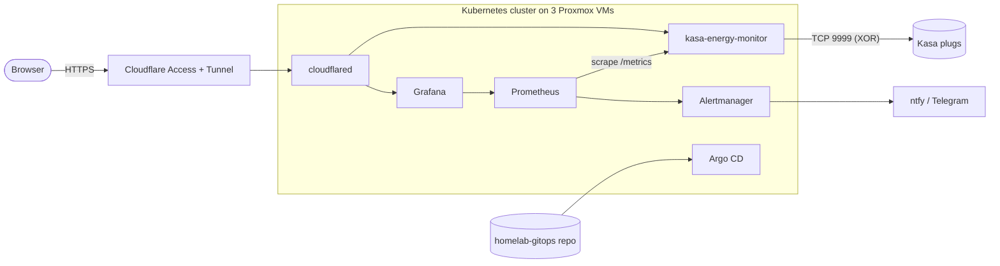

# Kasa Energy Monitor

Real-time energy monitoring and control for TP-Link Kasa smart plugs (HS110 / KP115),
built as a cloud-native application and operated on a self-hosted Kubernetes cluster
with GitOps.

> **Status: design phase.** This repository currently contains the architecture,
> repository structure and action plan. No application code has been written yet.
> Progress is tracked in [docs/action-plan.md](docs/action-plan.md).

---

## Why this project exists

The first version of this setup was assembled by hand: a community Prometheus exporter
(`tplink-plug-exporter` by fffonion), a public Grafana dashboard and a manually installed
monitoring stack. It worked, but:

- nothing was versioned — the cluster state lived only in the cluster;
- there was no live view and no way to switch plugs on or off from the dashboard;
- there were no alerts, no cost tracking in local currency and no runbooks;
- none of the software lifecycle (tests, CI, releases, packaging) was owned.

This project replaces that setup with a system built and operated the way it would be in a
production team: an owned, tested service; signed container images; a Helm chart;
declarative GitOps deployment with Argo CD; dashboards, alerts and documentation as code.

It is also a learning and portfolio project focused on **Kubernetes, delivery pipelines
and operations**.

## Features (planned)

| Area | Feature |
|---|---|
| Telemetry | Polls every plug every 5 s over the local Kasa protocol (TCP 9999) |
| Live UI | Dependency-free web UI with live updates via Server-Sent Events |
| Control | Switch plug relays on/off from the UI |
| Metrics | Prometheus metrics following naming conventions (base units, info metric) |
| History | Grafana dashboard as code: live power, daily/monthly kWh, cost per kWh |
| Alerting | Plug offline, abnormal load, voltage out of range, exporter down — with runbooks |
| Delivery | CI with lint, tests, vulnerability scanning, SBOM, signed multi-arch images |
| Deployment | Helm chart (OCI) deployed by Argo CD from a GitOps repository |
| Security | Cloudflare Tunnel + Access, NetworkPolicy, Pod Security `restricted`, Sealed Secrets |

## Architecture at a glance



Full details: [docs/architecture.md](docs/architecture.md).

## Tech stack

| Layer | Choice |
|---|---|
| Hardware | TP-Link Kasa HS110, KP115 (legacy XOR protocol, TCP 9999) |
| Application | Go (standard library + `prometheus/client_golang`), embedded HTML/CSS/JS |
| Container | Multi-stage build, distroless `static:nonroot` base image |
| CI/CD | GitHub Actions, GHCR, Trivy, Syft (SBOM), Cosign (keyless), release-please, Renovate |
| Packaging | Helm chart published as an OCI artifact to GHCR |
| Platform | Kubernetes on 3 Proxmox VMs, Argo CD (app-of-apps), Sealed Secrets |
| Observability | kube-prometheus-stack (Prometheus, Alertmanager, Grafana) |
| Exposure | Cloudflare Tunnel (`cloudflared`) + Cloudflare Access — no Ingress controller |

## Documentation

| Document | Content |
|---|---|
| [docs/architecture.md](docs/architecture.md) | System design, components, data flows, metrics, deployment topology, security, failure modes |
| [docs/action-plan.md](docs/action-plan.md) | Phased implementation plan with tasks and exit criteria |
| [docs/repository-structure.md](docs/repository-structure.md) | Layout of the application repo and the GitOps repo |
| [docs/adr/](docs/adr/) | Architecture Decision Records |

## Roadmap

| Phase | Goal | Status |
|---|---|---|
| 0 | Inventory of the existing cluster and preparation | ⬜ Not started |
| 1 | GitOps foundation: `homelab-gitops`, app-of-apps, Argo CD manages itself | ⬜ Not started |
| 2 | Adopt manually installed workloads into Argo CD without downtime | ⬜ Not started |
| 3 | Application: Go service, tests, embedded UI, simulator | ⬜ Not started |
| 4 | CI/CD and supply chain security | ⬜ Not started |
| 5 | Helm chart published to GHCR | ⬜ Not started |
| 6 | Shadow deployment next to the community exporter, then cutover | ⬜ Not started |
| 7 | Observability as code: dashboard, alerts, notifications, runbooks | ⬜ Not started |
| 8 | Hardening: Cloudflare Access, NetworkPolicy, Pod Security | ⬜ Not started |
| 9 | Portfolio polish: screenshots, demo, final documentation | ⬜ Not started |

## Getting started

_Not available yet — will be added in Phase 3._ The planned developer workflow:

```bash
make run PLUGS=192.168.1.101,192.168.1.102   # run locally against real plugs
make run-mock                                 # run with simulated plugs
make test lint                                # unit tests and linters
make demo                                     # kind cluster + full stack with simulated plugs
```

## License

To be decided (MIT suggested).
