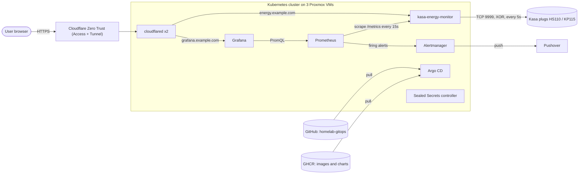
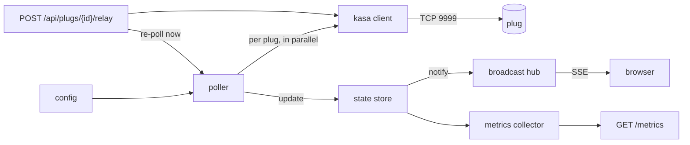
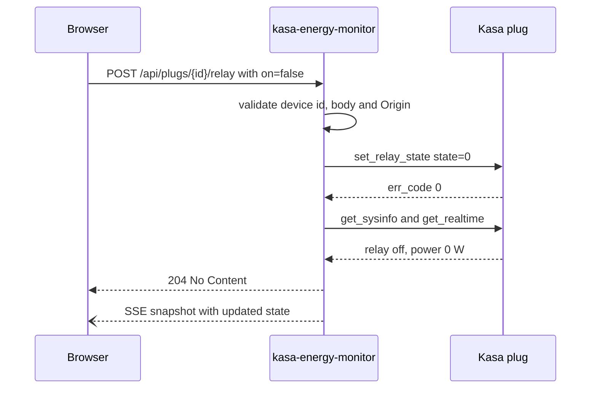
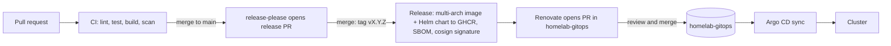

# Architecture

This document describes the target architecture of Kasa Energy Monitor and the platform
it runs on. Decisions referenced here are recorded in [adr/](adr/).

## Contents

1. [Goals and non-goals](#1-goals-and-non-goals)
2. [System context](#2-system-context)
3. [Components](#3-components)
4. [Application design](#4-application-design)
5. [Kasa protocol](#5-kasa-protocol)
6. [Data flows](#6-data-flows)
7. [Metrics model](#7-metrics-model)
8. [Configuration](#8-configuration)
9. [Deployment topology](#9-deployment-topology)
10. [Delivery pipeline](#10-delivery-pipeline)
11. [Security](#11-security)
12. [Reliability and failure modes](#12-reliability-and-failure-modes)
13. [Observability of the service itself](#13-observability-of-the-service-itself)
14. [Open questions](#14-open-questions)

---

## 1. Goals and non-goals

**Goals**

- Collect voltage, current, power, cumulative energy and relay state from every plug.
- Provide a live view (≤ 5 s latency) and on/off control through a web UI.
- Store history in Prometheus and visualise it in Grafana, including cost in local currency.
- Alert on plug outages, abnormal consumption and exporter failures.
- Deploy everything declaratively from Git with Argo CD; the cluster can be rebuilt from Git.
- Follow industry practices: tests, CI, signed images, versioned releases, documentation.

**Non-goals**

- Support for the newer KLAP/TPAP protocols (the plugs in use speak the legacy XOR protocol).
- TP-Link cloud API integration.
- High availability of the exporter (see [ADR-0004](adr/0004-single-replica.md)).
- Multi-user or multi-tenant features.

## 2. System context



| Actor / system | Role |
|---|---|
| User | Views live data and history, toggles plugs |
| Cloudflare Zero Trust | Public entry point: the Tunnel carries traffic, Access enforces identity before any request reaches the cluster |
| Pushover | Delivers alert notifications to the phone |
| Kasa plugs | Data source and control target on the home LAN, addressed by DHCP-reserved IPs |
| GitHub | Source code, GitOps state, CI (GitHub Actions) |
| GHCR | Container images and the Helm chart (OCI) |

## 3. Components

| Component | Namespace | Installed via | Responsibility |
|---|---|---|---|
| `kasa-energy-monitor` | `kasa` | Own Helm chart (OCI) | Polls plugs, serves UI, SSE, relay API and `/metrics` |
| Prometheus (+ operator) | `monitoring` | `kube-prometheus-stack` chart | Scraping, storage (1 year), alert evaluation |
| Alertmanager | `monitoring` | `kube-prometheus-stack` chart | Alert routing and notifications |
| Grafana | `monitoring` | `kube-prometheus-stack` chart (to confirm in Phase 0) | Dashboards; provisioned from ConfigMaps |
| cloudflared | `cloudflared` | Helm chart or manifests (to confirm in Phase 0) | Outbound tunnel to Cloudflare, routes hostnames to Services |
| Argo CD | `argocd` | Argo CD Helm chart, self-managed | Continuous reconciliation from `homelab-gitops` |
| Sealed Secrets | `kube-system` | `sealed-secrets` chart | Decrypts `SealedSecret` objects committed to Git |
| `tplink-plug-exporter` (legacy) | `monitoring` | Adopted as-is, removed in Phase 6 | Community exporter, kept only until cutover |

## 4. Application design

A single Go binary with an embedded web UI. Internal packages:

| Package | Responsibility |
|---|---|
| `internal/kasa` | Protocol: XOR framing, request/response, unit normalisation, relay command |
| `internal/poller` | Periodic parallel polling, timeouts, per-plug backoff, on-demand re-poll |
| `internal/state` | Thread-safe store of the latest reading per plug, change notifications |
| `internal/stream` | Broadcast hub that fans out snapshots to SSE clients |
| `internal/metrics` | Prometheus collector reading from the state store |
| `internal/httpapi` | HTTP routes, input validation, health endpoints |
| `internal/config` | Configuration file + environment overrides, validation |
| `internal/simulator` | Fake plugs for CI, demos and UI development |
| `web/` | `index.html`, `app.js`, `style.css` embedded with `go:embed` — no CDN |



### Polling

- Interval 5 s, per-request timeout 2 s, all plugs polled in parallel.
- A single request per plug combines `system.get_sysinfo` and `emeter.get_realtime`.
- An unreachable plug is retried with exponential backoff (5 s → 60 s) so that offline
  devices do not cost a timeout on every cycle; the last known identity (alias, model)
  is kept and the plug is reported with `online: false`.
- One TCP connection per request (the HS110 is known to misbehave with long-lived or
  very frequent connections, which is why the interval is not lower than 5 s).

See [ADR-0002](adr/0002-background-polling-with-cache.md) for why polling is decoupled
from Prometheus scrapes.

### HTTP API

| Method | Path | Description |
|---|---|---|
| `GET` | `/` | Embedded web UI |
| `GET` | `/api/plugs` | JSON snapshot of all plugs |
| `GET` | `/api/stream` | Server-Sent Events: a `snapshot` event on connect and after every poll cycle; heartbeat comment every 15 s |
| `POST` | `/api/plugs/{deviceId}/relay` | Body `{"on": true}`. Requires a valid Cloudflare Access JWT (when enabled); rejects unknown devices and invalid bodies; checks `Origin`. Disabled when `readOnly: true` |
| `GET` | `/metrics` | Prometheus exposition format |
| `GET` | `/healthz` | Liveness — the process is running and the HTTP server responds |
| `GET` | `/readyz` | Readiness — configuration loaded and the first poll cycle completed |

Readiness deliberately does **not** depend on plugs being online: if every plug is
unreachable, the UI must still be served so the user can see that.

### Web UI

- Plain HTML/CSS/JS, embedded in the binary; no Tailwind, no ECharts, no CDN
  ([ADR-0011](adr/0011-dependency-free-embedded-ui.md)).
- Summary cards: total power, plugs online, estimated cost per hour.
- One card per plug, keyed by `deviceId`; DOM nodes are updated in place, not re-rendered.
- Per-plug sparkline of the last 60 readings drawn as inline SVG.
- Connection indicator driven by `EventSource` `open`/`error` events.
- Links to the Grafana dashboard for history.

## 5. Kasa protocol

Legacy local protocol, no authentication.

- Transport: TCP, port 9999.
- Framing: 4-byte big-endian length prefix, followed by the payload.
- Payload: JSON, obfuscated with an autokey XOR cipher whose initial key is `171`
  (each ciphertext byte becomes the key for the next byte).

Request used for polling:

```json
{"system":{"get_sysinfo":{}},"emeter":{"get_realtime":{}}}
```

Relay command:

```json
{"system":{"set_relay_state":{"state":1}}}
```

Unit normalisation — hardware versions report different field names and units:

| Quantity | HS110 hw v1 | HS110 hw v2+, KP115 | Normalised to |
|---|---|---|---|
| Voltage | `voltage` (V) | `voltage_mv` (mV) | volts |
| Current | `current` (A) | `current_ma` (mA) | amperes |
| Power | `power` (W) | `power_mw` (mW) | watts |
| Energy | `total` (kWh) | `total_wh` (Wh) | joules |

Real responses from each plug model are captured in Phase 0 and stored as test fixtures.

## 6. Data flows

**Collection.** The poller queries every plug every 5 s and writes the result to the state store.

**Live view.** The browser opens `/api/stream`; after each poll cycle the broadcast hub
pushes a snapshot to every connected client. The UI never queries Prometheus.

**History.** Prometheus scrapes `/metrics` every 15 s (via a `ServiceMonitor`) and keeps
one year of data on a persistent volume. Grafana queries Prometheus.

**Alerting.** `PrometheusRule` objects are evaluated by Prometheus; Alertmanager sends
notifications to Pushover ([§ 13](#notifications-pushover)).

**Control.**



## 7. Metrics model

Follows the Prometheus naming conventions: base units, `_total` suffix for counters, and an
*info metric* for descriptive labels so that renaming a plug does not break its time series
([ADR-0008](adr/0008-device-identity-and-metric-units.md)).

| Metric | Type | Labels | Description |
|---|---|---|---|
| `kasa_plug_info` | gauge (=1) | `device_id`, `alias`, `model`, `hw_ver`, `sw_ver`, `mac`, `host` | Descriptive metadata |
| `kasa_up` | gauge | `device_id` | 1 if the last poll succeeded |
| `kasa_relay_on` | gauge | `device_id` | 1 if the relay is on |
| `kasa_power_watts` | gauge | `device_id` | Active power |
| `kasa_voltage_volts` | gauge | `device_id` | RMS voltage |
| `kasa_current_amperes` | gauge | `device_id` | RMS current |
| `kasa_energy_joules_total` | counter | `device_id` | Cumulative energy reported by the plug |
| `kasa_poll_duration_seconds` | histogram | `device_id` | Duration of a poll request |
| `kasa_poll_errors_total` | counter | `device_id`, `reason` | Failed polls (`timeout`, `refused`, `decode`) |

Example queries:

```promql
# Power per plug, labelled with its current name
kasa_power_watts * on(device_id) group_left(alias) kasa_plug_info

# Energy over the last 24 hours, in kWh
increase(kasa_energy_joules_total[1d]) / 3.6e6

# Cost of the last 30 days ($price_per_kwh is a Grafana dashboard variable)
sum(increase(kasa_energy_joules_total[30d])) / 3.6e6 * $price_per_kwh
```

Cost is computed in Grafana, not in the application: the price is presentation data and can
change without a redeploy.

## 8. Configuration

Configuration file (mounted from a ConfigMap generated by the Helm chart):

```yaml
listenAddr: ":8080"
pollInterval: 5s
pollTimeout: 2s
readOnly: false          # disables the relay endpoint (public demo)
cloudflareAccess:        # verify the Access JWT on write requests
  enabled: true
  teamDomain: <team>.cloudflareaccess.com
  audience: <access-application-aud-tag>
plugs:
  - host: 192.168.1.101
  - host: 192.168.1.102
    name: washing-machine  # optional; overrides the alias from the device
```

Environment overrides: `KASA_LISTEN_ADDR`, `KASA_POLL_INTERVAL`, `KASA_POLL_TIMEOUT`,
`KASA_READ_ONLY`, `KASA_PLUGS` (comma-separated hosts), `KASA_SIMULATOR_PLUGS`
(number of simulated plugs; replaces real plugs), `KASA_ACCESS_TEAM_DOMAIN`,
`KASA_ACCESS_AUDIENCE`, `KASA_LOG_LEVEL`.

Invalid configuration fails fast at start-up with a clear error.

## 9. Deployment topology

| Namespace | Workloads | Notes |
|---|---|---|
| `argocd` | Argo CD | Self-managed; root Application bootstraps everything else |
| `kube-system` | Sealed Secrets controller | Its private key is backed up outside the cluster |
| `monitoring` | Prometheus, Alertmanager, Grafana, operator, (legacy exporter) | Prometheus on a PVC, retention 1 year |
| `cloudflared` | cloudflared (2 replicas) | Tunnel token in a SealedSecret |
| `kasa` | kasa-energy-monitor (1 replica) | Pod Security `restricted`, NetworkPolicy |

Public hostnames (via Cloudflare Tunnel, no Ingress controller —
[ADR-0007](adr/0007-cloudflare-tunnel-without-ingress.md); each one is a Cloudflare Access
application — [ADR-0013](adr/0013-cloudflare-zero-trust.md)):

| Hostname | Target Service |
|---|---|
| `energy.example.com` | `http://kasa-energy-monitor.kasa.svc.cluster.local:80` |
| `grafana.example.com` | `http://<grafana-service>.monitoring.svc.cluster.local:80` |

Application pod specification highlights:

- 1 replica, `RollingUpdate` (a short overlap of two pollers is harmless: polling is read-only).
- Requests `cpu: 10m`, `memory: 32Mi`; memory limit `64Mi`; no CPU limit (avoids throttling).
- `runAsNonRoot`, `readOnlyRootFilesystem`, `allowPrivilegeEscalation: false`,
  `capabilities.drop: [ALL]`, `seccompProfile: RuntimeDefault`.
- Liveness on `/healthz`, readiness on `/readyz`.
- `ServiceMonitor` and `PrometheusRule` shipped by the chart (toggleable).

Network path to the plugs: pod → node (SNAT) → home LAN. The cluster VMs must have a
route to the plug subnet; this is already proven by the legacy exporter.

## 10. Delivery pipeline



- Every change reaches the cluster through a reviewed pull request in `homelab-gitops`.
- Images are referenced by tag **and** digest.
- Rollback = revert the version bump in `homelab-gitops`.

## 11. Security

| Layer | Control |
|---|---|
| Edge | Cloudflare Zero Trust: an Access application on every hostname; tunnel only, no inbound ports open on the home network |
| Identity | Signed Access JWT: single sign-on in Grafana, verified by the exporter on write requests |
| Application | Relay API accepts only configured devices, a strict JSON body and a valid Access JWT; `Origin` check; audit log with the user's e-mail; read-only mode |
| Pod | Pod Security Standard `restricted` enforced on the namespace; non-root, read-only FS |
| Network | NetworkPolicy: ingress from `cloudflared` and `monitoring` only; egress to the plug subnet on TCP 9999 and to DNS (requires a CNI that enforces policies) |
| Secrets | Only `SealedSecret` objects in Git; controller key backed up offline |
| Supply chain | Trivy scans, SBOM, cosign keyless signatures, pinned digests, Renovate updates, distroless base |
| Known limitation | The Kasa XOR protocol has no authentication — any LAN device can control the plugs. Mitigated only by network segmentation (IoT VLAN), outside the scope of this project |

### Cloudflare Zero Trust

Every public hostname is a **self-hosted Access application**. NetworkPolicy allows the UI
port to be reached only from `cloudflared`, so no request can skip Access.

| Setting | Value |
|---|---|
| Tunnel | Remotely managed in the Zero Trust dashboard; cloudflared runs with a token from a SealedSecret |
| Access applications | `energy.example.com`, `grafana.example.com` |
| Policy | Allow — only your own e-mail address |
| Identity provider | One-time PIN by e-mail to start; GitHub or Google login later |
| Session duration | 24 h |
| Optional | Require a WARP-enrolled device (device posture); configuration as code with Terraform |

After login, Cloudflare adds a signed JWT to every request in the `Cf-Access-Jwt-Assertion`
header. It is used twice:

**Grafana** trusts it for single sign-on, so there is no second password:

```ini
[auth.jwt]
enabled = true
header_name = Cf-Access-Jwt-Assertion
email_claim = email
username_claim = email
jwk_set_url = https://<team>.cloudflareaccess.com/cdn-cgi/access/certs
expect_claims = {"aud": ["<access-application-aud-tag>"]}
auto_sign_up = true
```

**kasa-energy-monitor** verifies it on the relay endpoint: signature against the team's
public keys (cached), `aud`, `iss` and expiry. A request without a valid token gets `401`.
The e-mail claim goes into the audit log:

```json
{"level":"INFO","msg":"relay toggled","device_id":"…","on":false,"user":"you@example.com"}
```

Read endpoints do not require the token, so Prometheus can scrape `/metrics` from inside the
cluster; they are still only reachable from the internet through Access.

## 12. Reliability and failure modes

| Failure | Effect | Detection / mitigation |
|---|---|---|
| One plug offline | Card shows offline; no new samples | `kasa_up == 0` → `KasaPlugDown` after 5 min; backoff limits poll cost |
| All plugs offline (e.g. Wi-Fi down) | UI served, everything offline | Readiness unaffected; alerts fire per plug |
| Plug IP changes | Plug appears offline | DHCP reservations; device identity is `device_id`, not IP |
| Exporter crash | Gap in metrics, UI down | Kubernetes restarts the pod; `KasaExporterDown` alert on `up == 0` |
| Prometheus down | No history/alerts; live UI unaffected | Watchdog alert from kube-prometheus-stack |
| Cloudflare outage | No remote access | `kubectl port-forward` for local access |
| Plug energy counter reset | Counter drops | `increase()` handles counter resets |
| Cluster rebuilt | — | Bootstrap Argo CD + root Application; restore Sealed Secrets key; everything else from Git |

## 13. Observability of the service itself

- **Logs:** structured JSON via `log/slog` to stdout; one line per state change
  (plug went offline/online, relay toggled), not per poll.
- **Metrics:** `kasa_poll_duration_seconds`, `kasa_poll_errors_total`, Go runtime and process metrics.
- **Alerts** (each with a runbook in `docs/runbooks/`):

| Alert | Condition | Severity |
|---|---|---|
| `KasaExporterDown` | `up{job="kasa-energy-monitor"} == 0` for 5 min | critical |
| `KasaPlugDown` | `kasa_up == 0` for 5 min | warning |
| `KasaPollErrorsHigh` | error ratio > 20 % for 15 min | warning |
| `KasaHighPower` | `kasa_power_watts` above a configurable threshold for 10 min | warning |
| `KasaVoltageOutOfRange` | voltage outside 207–253 V (230 V ± 10 %) for 5 min | warning |

### Notifications (Pushover)

Alertmanager has a native Pushover receiver, so no bridge service is needed
([ADR-0012](adr/0012-pushover-notifications.md)). The configuration lives in the
kube-prometheus-stack values in `homelab-gitops`. The user key and the application token come
from a SealedSecret mounted into Alertmanager as files, so they never appear in Git or in the
rendered configuration.

| Severity | Pushover priority | Effect on the phone |
|---|---|---|
| `critical` | 1 (high) | Bypasses quiet hours |
| `warning` | 0 (normal) | Normal notification |
| `info` (e.g. appliance finished) | -1 (low) | No sound or vibration |
| `Watchdog`, `InfoInhibitor` | — | Sent to a `null` receiver |

```yaml
# homelab-gitops/values/kube-prometheus-stack.yaml (excerpt)
alertmanager:
  alertmanagerSpec:
    secrets: [alertmanager-pushover]   # mounted at /etc/alertmanager/secrets/alertmanager-pushover/
  config:
    route:
      receiver: pushover-normal
      group_by: [alertname, device_id]
      routes:
        - receiver: "null"
          matchers: ['alertname =~ "Watchdog|InfoInhibitor"']
        - receiver: pushover-high
          matchers: ['severity = "critical"']
        - receiver: pushover-low
          matchers: ['severity = "info"']
    receivers:
      - name: "null"
      - name: pushover-normal
        pushover_configs:
          - &pushover
            user_key_file: /etc/alertmanager/secrets/alertmanager-pushover/user_key
            token_file: /etc/alertmanager/secrets/alertmanager-pushover/token
            priority: "0"
            url: '{{ (index .Alerts 0).Annotations.runbook_url }}'
            url_title: Runbook
            send_resolved: true
      - name: pushover-high
        pushover_configs:
          - <<: *pushover
            priority: "1"
      - name: pushover-low
        pushover_configs:
          - <<: *pushover
            priority: "-1"
            send_resolved: false
```

Each message carries the alert summary, the plug name and a link to its runbook; a second
message is sent when the alert resolves.

## 14. Open questions

To be answered in Phase 0 (see [action-plan.md](action-plan.md)):

- Kubernetes distribution and version on the Proxmox VMs; CNI and whether it enforces NetworkPolicy.
- Available StorageClass for Prometheus and Grafana volumes.
- Is Grafana part of kube-prometheus-stack or a separate release?
- How cloudflared was installed and whether the tunnel is dashboard-managed or config-file managed.
- Cloudflare Zero Trust team domain and which identity provider to use.
- How the community exporter was installed and which metric names the current dashboard uses.
- Hardware and firmware version of every plug.
